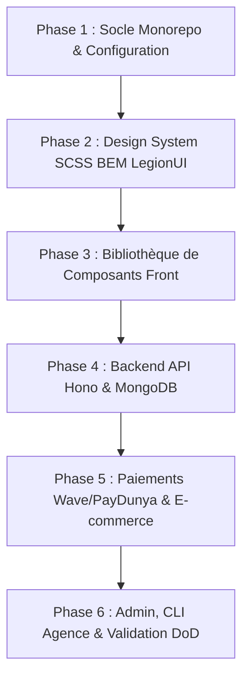

# Plan Stratégique de Finalisation : Boilerplate `webAgency`

---

## 1. Définition du Résultat Final Souhaité

Le résultat final souhaité n'est pas une simple collection de règles textuelles, mais un **dépôt modèle (Template Repository) complet, testé et prêt à l'emploi** permettant à l'agence de livrer un site vitrine ou e-commerce pour n'importe quel commerce traditionnel en **moins de 30 minutes** à partir d'une interview.

### Livrables concrets attendus dans le dépôt `webAgency` :

1. **Un Monorepo propre (`site/` + `api/`)** :
   - `site/` : Application **Astro 5** en sortie statique pure, déployable en 30 s sur **GitHub Pages** (coût hébergement = 0 €).
   - `api/` : Micro-API **Hono** ultra-légère (Node/Vercel Serverless), assurant la sécurité, l'accès MongoDB Atlas, Clerk, Cloudinary et les webhooks de paiement.
2. **Le Design System SCSS BEM LegionUI opérationnel** :
   - Fichiers d'abstracts (`_tokens.scss`, `_mixins.scss`, `_breakpoints.scss`) pilotés par les variables de `client.json`.
   - Respect strict des 5 sections BEM (`Function`, `Variables`, `Placeholder` avec `--template` Emmet, `Mixin` avec mappage mixte dynamique, `Mapping Sémantique Natif`).
   - Zéro classe utilitaire dans le markup, suppression des wrappers superflus (anti-oignon).
3. **Une Bibliothèque de Composants documentée (`site/src/components/library/`)** :
   - Le catalogue visuel interactif sur la route `site/src/pages/_catalogue.astro` (outil de dev et de démonstration commerciale).
   - Composants clés intégrés :
     * `Accordion` (modèle LegionUI avec modificateurs `--default` et `--chrome`).
     * `Header` (sticky, responsive, micro-interactions).
     * `Footer` (original, section contact complète, Leaflet au clic, badge Ouvert/Fermé temps réel).
     * `FabContact` (speed dial WhatsApp + appel en bas à droite).
     * `FabTools` & `RoleSimulator` (boutons fixes en bas à gauche, sélecteur de rôle).
     * `Spinner` (CSS pur sémantique `<progress>`) et `Skeleton` (zéro CLS).
     * `ServiceCard` et `ProductCard` avec le pattern lien-modale (SEO natif + modale `<dialog>`).
4. **Backend Serverless sécurisé (`api/`)** :
   - Endpoints de lecture temps réel `/api/services`, `/api/hours`, `/api/contact`.
   - Middleware d'authentification Clerk et gestion des rôles (`public`, `admin`).
   - Prise en charge du simulateur de rôle via l'en-tête `X-Simulated-Role` et isolation sur la base MongoDB `demo_<slug>`.
   - Script de seed idempotent (`npm run seed` et `npm run seed:demo`).
   - Module de paiement Wave (QR code / lien app) et PayDunya avec vérification stricte par webhook.
5. **Outillage Agence & Automatisation** :
   - Script CLI d'initialisation d'un nouveau client (`npm run init:client <slug>`).
   - Workflow GitHub Actions de déploiement automatique sur GitHub Pages (`.github/workflows/deploy.yml`).

---

## 2. Découpage du Plan en 6 Phases Opérationnelles

### Phase 1 : Socle Monorepo, Astro & Tooling
* Initialisation de la racine du dépôt git `webAgency` et configuration des workspaces npm (`site`, `api`).
* Mise en place d'Astro 5 (`site/`) en mode statique avec intégration SCSS.
* Configuration du workflow GitHub Actions (`.github/workflows/deploy.yml`) avec support de `CNAME`.
* Mise en place de `site/src/lib/storage.ts` (clé unique `<slug>:app`, schéma versionné).

### Phase 2 : Design System SCSS BEM LegionUI
* Création de l'arborescence SCSS (`styles/abstracts/`, `styles/base/`).
* Générateur de tokens CSS dynamiques à partir de `client.json` (`--color-primary`, etc.).
* Reset moderne (`modern-normalize`) et mixins globales de positionnement BEM.
* Intégration du composant modèle `Accordion` issu de LegionUI dans `site/src/components/library/contenu/Accordion/`.

### Phase 3 : Bibliothèque de Composants Front & Catalogue Visuel
* Création des composants de feedback : `Spinner` CSS léger et `Skeleton`.
* Composants de mise en page : `Header` sticky, `Footer` original avec badge Ouvert/Fermé et Leaflet façade.
* Composants fixes : `FabContact` (bas droite), `FabTools` / simulateur (bas gauche).
* Pattern lien-modale pour les cartes de prestations / produits (`ServiceCard`).
* Création de la page `/_catalogue` servant de showcase pour tous les composants.

### Phase 4 : API Hono, Base de Données MongoDB & Sécurité
* Initialisation du workspace `api/` avec Hono, Zod, et le driver officiel MongoDB.
* Routes `/api/services`, `/api/hours`, `/api/contact` avec CORS strict.
* Middleware Clerk (`@clerk/backend`) et middleware du simulateur de rôle (`demo_<slug>`).
* Script de seeding idempotent `api/scripts/seed.ts` (génération à partir de `client.json`).

### Phase 5 : E-commerce & Tunnels de Paiement
* Panier interactif côté front branché sur `storage.ts`.
* Endpoints de commande et session de paiement :
  - Wave Checkout (QR code desktop, deep link app mobile).
  - PayDunya Checkout.
  - Commande directe WhatsApp.
* Gestion des webhooks Wave / PayDunya avec validation de signature.

### Phase 6 : Dashboard Admin, Script d'Onboarding & Validation Finale
* Interface admin à tiroir latéral gauche (`/admin`).
* Script CLI d'onboarding (`scripts/init-client.ts`) automatisant la création d'un projet client.
* Audit complet selon `99-definition-of-done.md` (Lighthouse mobile ≥ 90, WCAG 2.2 AA, builds propres).

---

## 3. Estimation des Prompts et des Tokens

### Décomposition par Phase :

| Phase | Objectif clé | Nombre de prompts estimés | Tokens Entrée (Input) | Tokens Sortie (Output) |
|---|---|:---:|:---:|:---:|
| **Phase 1** | Monorepo, Astro, GitHub Actions, storage.ts | 2 – 3 prompts | ~40 000 – 60 000 | ~6 000 – 8 000 |
| **Phase 2** | Architecture SCSS BEM LegionUI & Tokens | 2 – 3 prompts | ~50 000 – 70 000 | ~7 000 – 9 000 |
| **Phase 3** | Bibliothèque de composants & Page `/_catalogue` | 4 – 5 prompts | ~100 000 – 140 000 | ~12 000 – 16 000 |
| **Phase 4** | API Hono, MongoDB Atlas, Clerk, Seed idempotent | 3 – 4 prompts | ~80 000 – 110 000 | ~9 000 – 12 000 |
| **Phase 5** | Panier, Wave (QR code), PayDunya, Webhooks | 2 – 3 prompts | ~60 000 – 80 000 | ~7 000 – 9 000 |
| **Phase 6** | Admin tiroir, script CLI init-client, audit DoD | 2 – 3 prompts | ~50 000 – 70 000 | ~6 000 – 8 000 |
| **TOTAL** | **Boilerplate complet livré et testé** | **15 à 21 prompts** | **~380 000 à 530 000** | **~47 000 à 62 000** |

### Synthèse budgétaire :
* **Nombre de tours d'interaction (Prompts)** : **~18 prompts en moyenne** (en procédant par validation d'étapes cohérentes).
* **Consommation globale estimée** :
  - **Tokens de contexte (Input)** : **~450k tokens** au total.
  - **Tokens de génération (Output)** : **~55k tokens** au total.
* **Optimisation possible** : En regroupant certaines étapes connexes (ex. Phase 1 + 2 ensemble, Phase 4 + 5 ensemble), le projet peut être bouclé en **8 à 10 gros prompts**.
